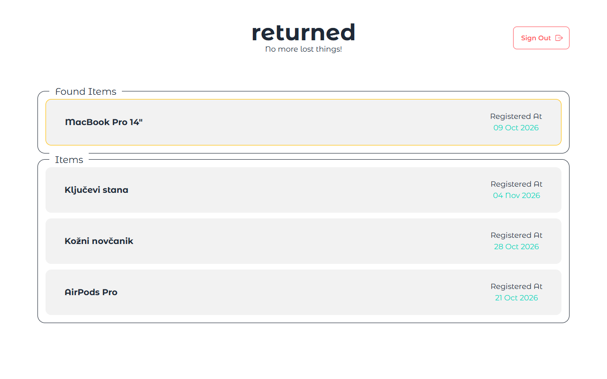
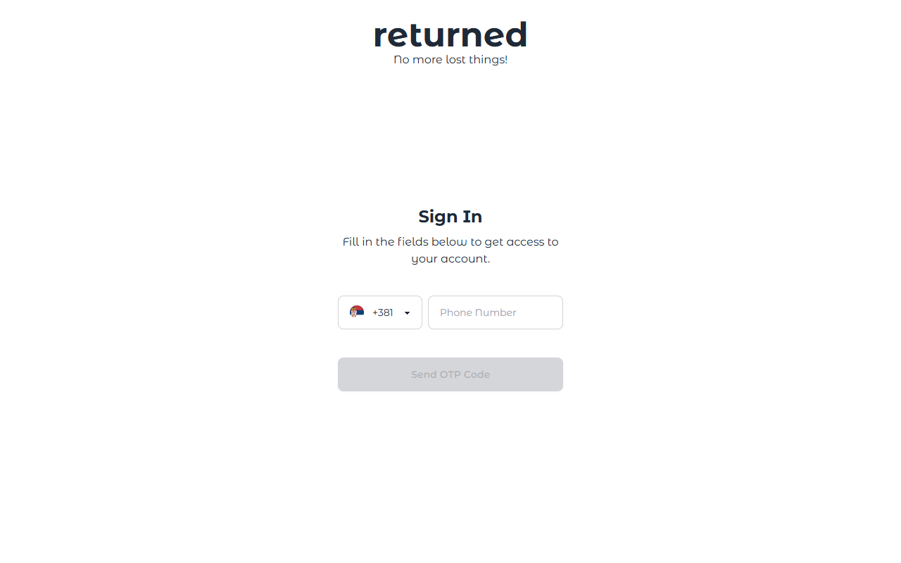
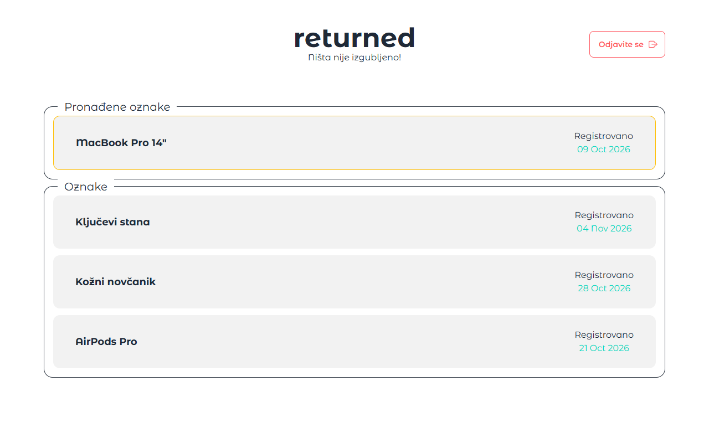
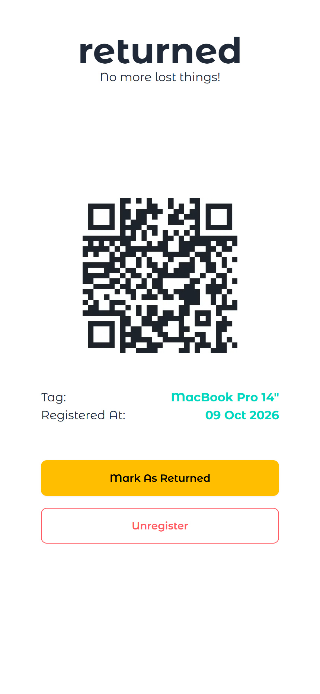
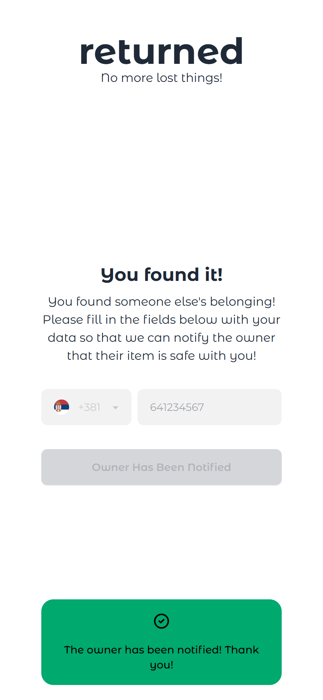
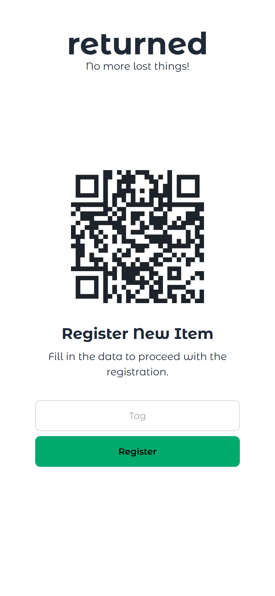
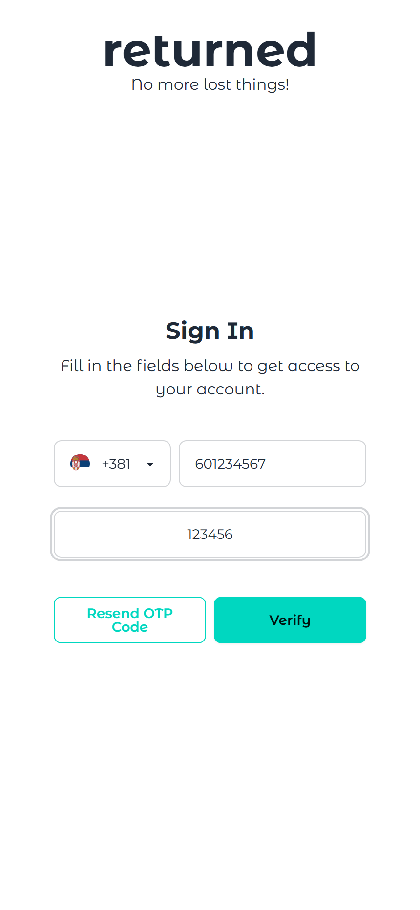
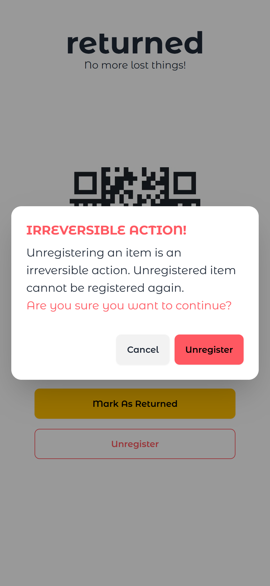

<div align="center">
  <h1>returned</h1>
  <p><strong>Ništa nije izgubljeno.</strong></p>
  <p>Web aplikacija za pametne QR/NFC naljepnice koje pronađene predmete vraćaju vlasnicima — bez otkrivanja ličnih podataka.</p>
</div>

---



## O projektu

`returned` je Next.js aplikacija za sistem pronađenih predmeta. Vlasnik na predmet stavi QR/NFC naljepnicu, registruje je pod svojim nalogom i od tog trenutka svako ko pronađe predmet može da skenira naljepnicu, vidi osnovne informacije i obavijesti vlasnika putem SMS-a.

Aplikacija je namjerno napravljena tako da **pronalazač nikada ne vidi broj telefona vlasnika**, a vlasnik dobija samo broj pronalazača kako bi mogao da ga kontaktira.

## Kako radi?

1. **Vlasnik se prijavi** brojem telefona i OTP kodom.
2. **Registruje naljepnicu** unošenjem naziva predmeta (npr. „MacBook Pro 14“).
3. **Naljepnica vodi na javnu stranicu** `/item/[id]` — QR kod se generiše automatski.
4. **Pronalazač skenira QR kod**, vidi da je predmet pronađen i ostavi svoj broj telefona.
5. **Vlasnik dobija SMS** sa informacijom koji je predmet pronađen i brojem telefona pronalazača.
6. **Vlasnik označi predmet kao vraćen** ili ga odjavi iz sistema.

## Slike

<table>
  <tr>
    <td align="center" width="50%">
      <br />
      <sub>Prijava brojem telefona</sub>
    </td>
    <td align="center" width="50%">
      <br />
      <sub>Komandna tabla — srpski jezik</sub>
    </td>
  </tr>
</table>

<p align="center">
  
  
  
</p>

<p align="center">
  <sub>Pronađen predmet · Obavještavanje vlasnika · Registracija nove naljepnice</sub>
</p>

<details>
  <summary>Još slika: OTP verifikacija i zaštita od slučajne odjave</summary>
  <p align="center">
    
    
  </p>
</details>

## Tehnologije

-   **Next.js 14** (App Router, React Server Components)
-   **TypeScript** sa striktnim podešavanjima
-   **tRPC v10** za tipiziran API
-   **Supabase** (PostgreSQL, Auth sa telefonskim OTP-om)
-   **Twilio** za SMS obaveštenja
-   **Tailwind CSS + daisyUI** za UI
-   **next-intl** za srpski i engleski jezik
-   **Zod** za validaciju ulaza
-   **TanStack Query** za keširanje na klijentu
-   **QuickChart** za generisanje QR kodova
-   **IPinfo** i **restcountries.com** za detekciju države

## Arhitektura

```text
┌──────────────────────────────┐
│  Browser (React / Next.js)   │
└──────────────┬───────────────┘
               │ tRPC
┌──────────────▼───────────────┐
│  Next.js App Router + RSC    │
│  src/app/[lang]/...          │
└──────┬───────────────┬───────┘
       │               │
┌──────▼──────┐  ┌─────▼──────────────┐
│  Supabase   │  │  Twilio            │
│  Postgres   │  │  SMS obaveštenja   │
│  Auth OTP   │  └────────────────────┘
└─────────────┘
       │
┌──────▼───────────────────────┐
│  IPinfo + restcountries.com  │
│  detekcija države            │
└──────────────────────────────┘
```

Server-side integracije nalaze se u `src/server/`:

-   `supabase.ts` — Supabase klijent sa service role ključem
-   `twilio.ts` — Twilio klijent za slanje SMS-a
-   `data/countries.ts` — lista država i pozivnih brojeva
-   `data/ip.ts` — detekcija države na osnovu IP adrese

## Pokretanje

### 1. Instalacija

```bash
bun install
```

### 2. Environment promenljive

Napravi `.env` fajl u korijenu projekta:

| Promenljiva                      | Opis                             |
| -------------------------------- | -------------------------------- |
| `NEXT_PUBLIC_SUPABASE_URL`       | URL Supabase projekta            |
| `NEXT_PUBLIC_SUPABASE_ANON_KEY`  | Supabase anon key                |
| `NEXT_SUPABASE_SERVICE_ROLE_KEY` | Service role key (samo server)   |
| `TWILIO_ACCOUNT_SID`             | Twilio Account SID               |
| `TWILIO_MESSAGING_AUTH_TOKEN`    | Twilio auth token                |
| `IPINFO_API_KEY`                 | IPinfo token za detekciju države |

### 3. Baza

Potrebno je kreirati tabele u Supabase SQL editoru:

```sql
create table "NonRegisteredItems" (
  id text primary key,
  "createdAt" timestamptz not null default now()
);

create table "RegisteredItems" (
  id text primary key,
  tag text not null,
  "ownerId" uuid not null references auth.users (id),
  "createdAt" timestamptz not null default now(),
  "registeredAt" timestamptz not null default now()
);

create table "FoundItems" (
  id text not null references "RegisteredItems" (id),
  "finderPhoneNumber" text not null,
  "foundAt" timestamptz not null default now(),
  "isReturned" boolean not null default false
);
```

U Supabase Auth-u uključi **Phone provider** i poveži ga sa Twilio nalogom.

### 4. Pokretanje

```bash
bun run dev       # razvoj
bun run build     # produkcijski build
bun run start     # produkcijski server
```

## Struktura projekta

```text
src/
├── app/
│   ├── [lang]/
│   │   ├── dashboard/           # lista mojih naljepnica
│   │   ├── item/[id]/           # javna stranica naljepnice
│   │   └── sign-in/             # prijava telefonom + OTP
│   ├── api/
│   │   ├── auth/callback/       # Supabase auth callback
│   │   └── trpc/[trpc]/         # tRPC handler
│   └── [lang]/layout.tsx
├── server/
│   ├── api/routers/             # auth, item, misc
│   ├── data/                    # države i IP detekcija
│   ├── supabase.ts
│   └── twilio.ts
├── messages/                    # en.json, sr.json
├── trpc/                        # klijent, server, React provider
├── types/                       # database, item, country tipovi
└── utils/
```

## Model podataka

-   `NonRegisteredItems` — naljepnice koje još nisu povezane sa korisnikom.
-   `RegisteredItems` — naljepnice povezane sa vlasnikom (`ownerId`) i nazivom predmeta (`tag`).
-   `FoundItems` — istorija pronalazaka; `isReturned` označava da je predmet vraćen.

Registracija pomjera zapis iz `NonRegisteredItems` u `RegisteredItems`. Odjava briše zapis iz `RegisteredItems`, a pronalazak se čuva u `FoundItems` dok se ne označi kao vraćen.

---

<div align="center">
  <sub>Napravljeno sa Next.js, tRPC i Supabase.</sub>
</div>
